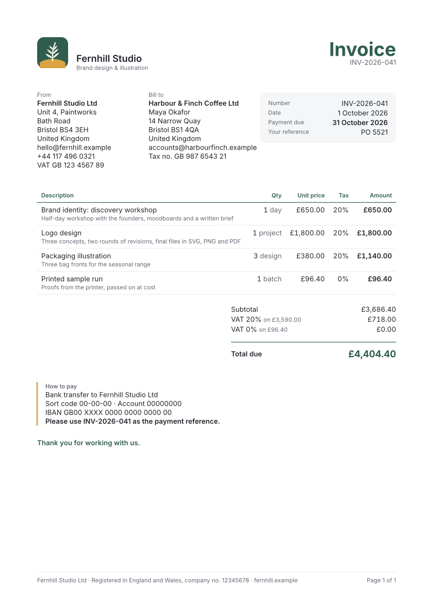
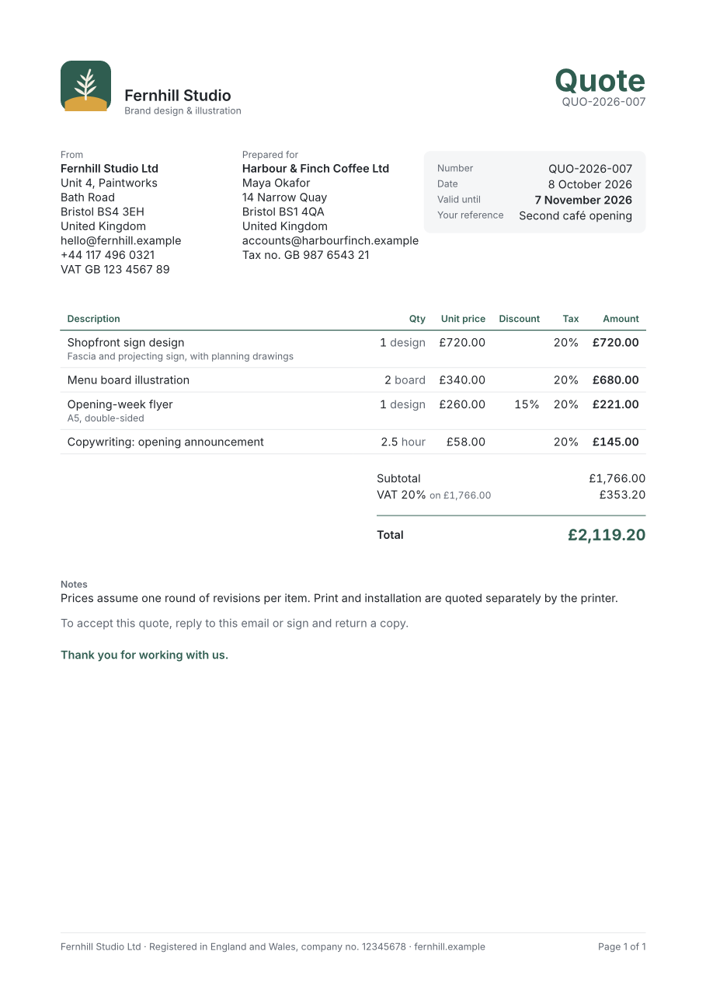
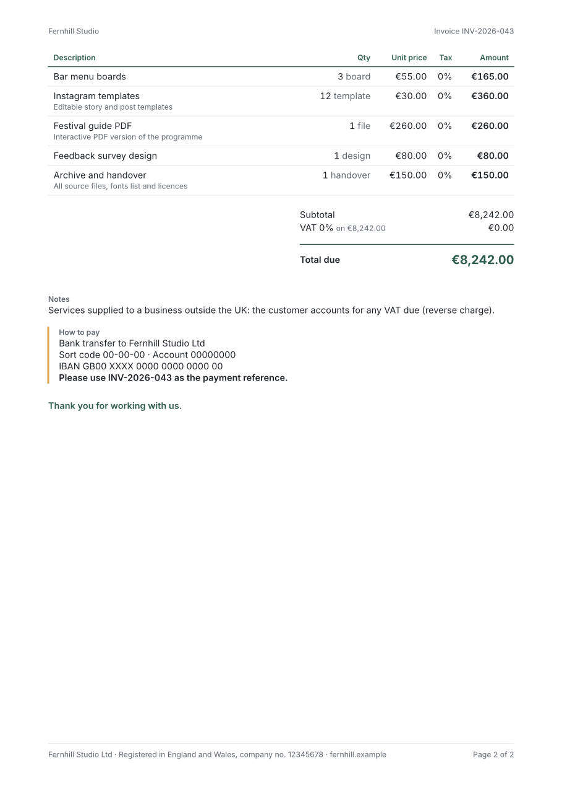

# Typst Invoices & Quotes

> **Free CodePlate template, v1.1.4.** This repository mirrors the zip on [codeplate.io](https://codeplate.io/t/typst-documents/).
> Press **Use this template** to start your own repository from it, or [download the zip](https://codeplate.io/t/typst-documents/).
> [All templates](https://codeplate.io/) · [Free License](https://codeplate.io/license/free/) · subscribers get it under the [Pro License](https://codeplate.io/license/pro/) with no credit.



Branded PDF invoices, quotes and credit notes from a spreadsheet, built so your AI agent can set them up for *your* business: freelancers, studios, translators, consultants, small shops.

## What's inside

- **A complete invoice and quote generator** for a sample design studio: your details, logo and colours in one file (`business.json`), clients in a CSV, line items in a CSV (one row per line, export it from any spreadsheet) or JSON from another app.
- **One-command import** of your monthly export (a time tracker, a jobs list): one invoice per client, numbered on, and running it twice adds nothing.
- **Money done right:** exact decimal math (never floating point), discounts, a minimum charge per line, unit prices like £0.0875 per word, several tax rates with tax worked out per rate, invoices in any currency with the right formatting.
- **Sent means sent:** once you've sent an invoice, one command freezes it (the PDF and its data are archived), so a new address or rate never changes what your client has. Corrections are credit notes that must refer to an issued invoice.
- **Numbering that keeps you out of trouble:** patterns like `INV-2026-041`, continuing from the last number you sent, a stored counter so deleting rows never restarts it, and a check that fails if a number is missing from the sequence.
- **Other languages per client:** English plus German, French, Spanish and Polish labels (to be checked by a native speaker before use), dates and amounts in the client's format, and a guide to add another language.
- **Typeset by [Typst](https://typst.app):** clean A4 or US Letter pages, a table header that repeats on every page, "Page 1 of 2", payment details, notes. PDF/A-3b output with the fonts embedded, the same file on every computer.
- **Checks in a few seconds:** one command checks your data, the math, every PDF, that every line and the right total made it onto the page, and that sent documents are unchanged.
- **For your agent:** a brief (`AGENTS.md`), fourteen step-by-step recipes (removing the sample, rebranding, numbering, adding and issuing documents, credit notes, imports, minimum charges, tax set-ups, languages and currencies, layout, fonts, other document types, e-invoicing), and page previews as images so it can see what it made.

| | |
|---|---|
|  |  |

## Use it with your agent

1. Unzip this folder where you want your invoices to live.
2. Install [Node.js](https://nodejs.org) 22 or newer and [Typst](https://typst.app) 0.15 (Windows: `winget install --id Typst.Typst -e --version 0.15.1`; macOS: `brew install typst`). Your agent can do this with you.
3. Open the folder with your agent (Claude Code or similar) and say something like:

> This is an invoice template from CodePlate. Read AGENTS.md, then set it up for my translation business: I invoice per word, some clients pay in euros, and my last invoice was number 2026-118.

The agent will ask you a few questions (your details, tax, numbering, payment terms), record your decisions in `docs/project.md`, and change the template step by step, running the checks and looking at the pages after each change.

## Run it yourself

```
npm run check                   # everything; ends with CODEPLATE CHECKS: PASS
npm run build                   # PDFs in out/
npm run preview                 # page images in shots/
npm run next -- invoice         # the next invoice number
npm run import -- jobs.csv      # this month's line items from your export
npm run issue -- INV-2026-042   # after you've sent it: freeze it in archive/
npm run export                  # out/summary.csv for your bookkeeping
npm run remove-sample -- --yes  # take the sample business out
```

There's nothing to `npm install`: the scripts use only what comes with Node. Keep `archive/` in your backups: it's the record of what you sent.

## License

You can use and change this template to make your own invoices and quotes, including commercially, and send the documents you make to anyone. If you share or publish the project itself (the generator), its documentation must keep the credit "Built with CodePlate (codeplate.io)". You can't resell the template itself. See LICENSE.md. The Inter fonts are under the SIL Open Font License (`assets/fonts/OFL.txt`); Typst is Apache-2.0.

This template doesn't give tax or legal advice, and its translations haven't been checked by native speakers: check what your invoices must say, in each language, with your accountant or tax authority.

Built with CodePlate (codeplate.io).
